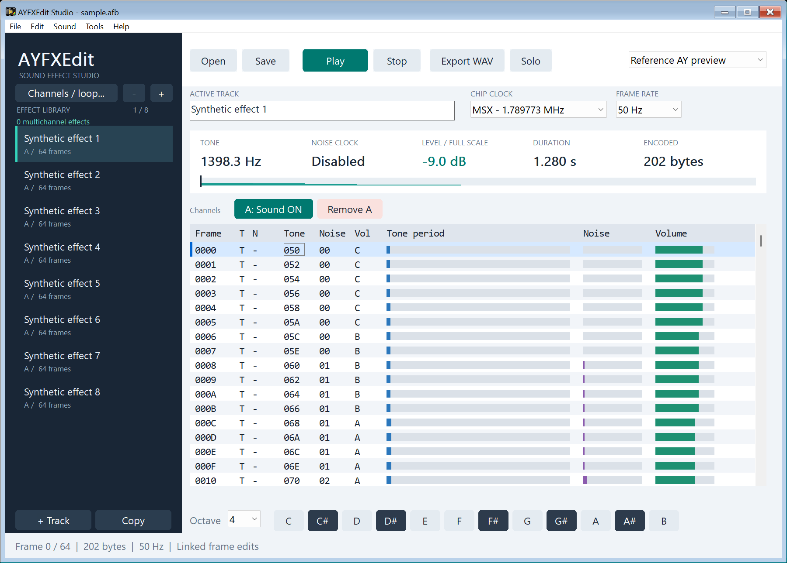
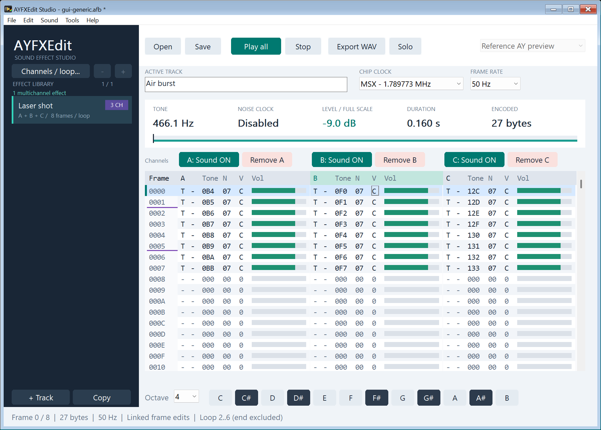
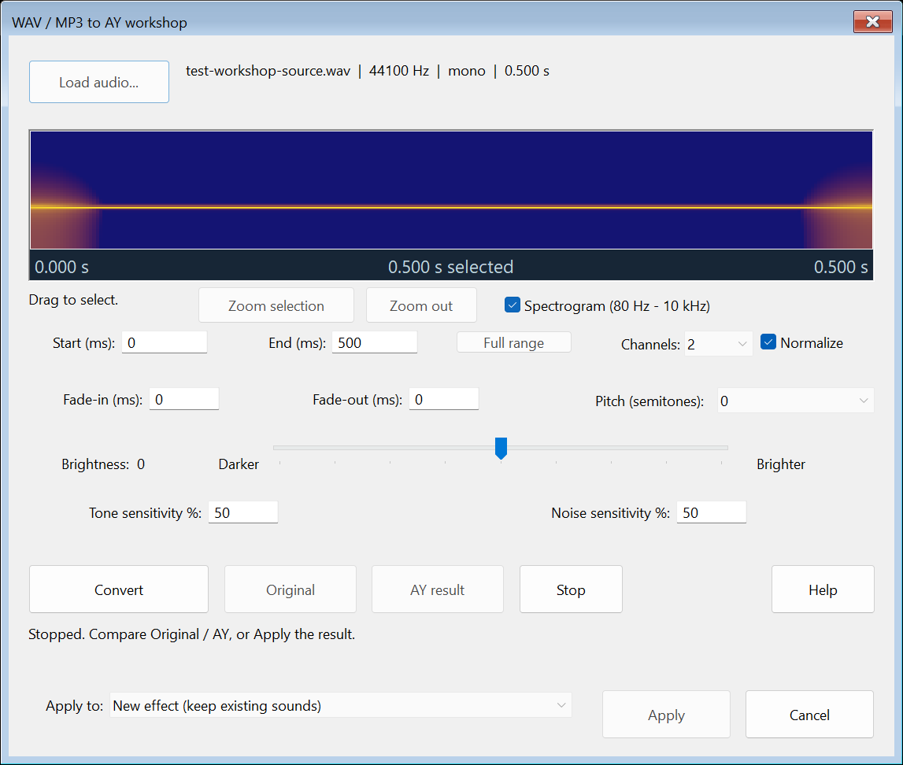

# AYFXEDIT — NEXT GEN

Native Windows AY sound-effect editor for **MSX and ZX Spectrum**, maintained by **Max Iwamoto**. Based on **Shiru's AY Sound FX Editor v0.6** and **Threetwosevensixseven's ayfxedit-improved**.

## Download

[Download the latest Windows x64 build](https://github.com/maxiwamoto/ayfxedit-next-gen-public/releases/latest). Extract the portable ZIP and run `ayfxedit-next-gen.exe`. No installer, C++ Builder, .NET, Python or compiler is needed to run it. Windows 10/11 x64 is the supported build target. MP3 import uses Windows Media Foundation (the Media Feature Pack is needed on Windows N).

The release includes the executable, documentation, credits and SHA-256 checksums. Source is available here and as a matching release ZIP. Press **F1** for the built-in guide.

## Screenshots

Captured from the Windows build using synthetic demo effects and audio. Click an image to view it at full size.

### Editor and effect library

Browse effects, edit tone/noise/volume values, draw parameter bars, and audition sounds with the selected chip clock and frame rate.



### Multichannel editing

Edit three synchronized AY channels side by side, with independent sound/remove controls and visible loop markers.



### WAV / MP3 workshop

Trim and inspect source audio, view its spectrogram, adjust conversion settings, and compare the original with the AY result before applying it.



## What NEXT GEN improves

| Area | Additions and changes |
|---|---|
| Current Windows build | Native Win32/C++17 x64 editor; no VCL/C++ Builder runtime dependency. |
| Multichannel editing | Group one, two or three AY channels; linked frame edits, channel assignment/removal, mutes, solo, undo/redo and loop markers. |
| Sound design | Curve designer, generators, pitch transposition/vibrato, hardware envelopes with explicit retriggers, shared noise/envelope conflict checks. |
| WAV/MP3 workshop | Trim and zoom, spectrogram, pitch and tone/noise controls, fades, source/result comparison, background conversion and cancellation. Retain the source excerpt and conversion settings in the project. |
| Preview and timing | Fractional AY clock accumulation, correct frame-zero application and 50/60 Hz scheduling; reference/legacy preview; continuous oscillator/noise/envelope state across loops. |
| Library workflow | Tags, favourites, search, priorities, batch import/export, autosave/recovery, keyboard navigation and restored focus when switching windows. |
| Game export | Compact tniASM and SDCC C players for MSX/Spectrum; multichannel effects, priorities, loops, hardware envelopes and optional music sharing. SDK sources are embedded in the executable. |
| Interchange | Classic AFX/AFB, WAV/CSV/VT2 exports, AY14/PSG11 register export with timing metadata, PSG and uncompressed single-AY VGM extraction. |
| Reliability | Bounds/offset checks, project rollback, synthetic regression fixtures, GUI smoke tests, and compiled Z80 register-trace tests. |

See [changes](CHANGELOG.md), [the editor guide](native/README.md), [SDK integration](runtime/README.md) and [register export](docs/register-export.md).

## Compatibility and limits

Classic `.afx` / `.afb` remains the legacy interchange format. Keep the companion `.ayfx-project` file to retain grouping, loops, hardware envelopes, tags and source audio. Explicit classic exports reject envelope content instead of silently losing it.

Audio conversion approximates sound with AY tones/noise/envelopes; it does **not** stream PCM or promise an exact recording match. This is an effects editor, not a music sequencer. VTX import is not supported. Single-AY VGM timing is quantized to the chosen 50/60 Hz tick rate. The UI is system-DPI-aware; reopen it after a per-monitor DPI change.

Exported SDK examples are callable game modules, not bootable ROMs. Music sharing must respect the AY's shared noise/envelope registers and the host's audio interrupt. See the SDK contract before integration.

## Build from source

Install **Visual Studio C++ Build Tools 2019 or later**, its Windows SDK, and **Python 3** on PATH. Then run:

```bat
build_native.bat
start_native.bat
```

The executable is `native/dist/ayfxedit-next-gen.exe`. Set `AYFX_EXE` to build a side-by-side executable while another copy is open. Build outputs are ignored by Git.

## Validate

```bat
test_native.bat
python tools/format_asm.py --check
```

Tests generate eight original synthetic effects and a bank, so no commercial game assets or old effect library are required. Native tests cover codecs, project persistence, conversion, envelopes, grouping and loops. GUI tests exercise editing, focus restoration, viewport scrolling, guide/dialogs, undo and audio startup. Windows audio startup is not a substitute for listening on hardware.

To test the exported players, install **tniASM** (with its `compat.asm`) and **SDCC**. Set `TNIASM` and `SDCC` to their executable paths, or put them on PATH. Install the test-only emulator and run:

```bat
python -m pip install --target native/build/test-deps z80==1.2.0
test_players.bat
```

This assembles the normal/small tniASM players and compiles/links the SDCC players for both platforms, then compares their PSG writes and checks priorities, loops, music restoration, GPIO bits and interrupt neutrality. Platform contention and full-game integration still need target-specific tests.

## Source layout and provenance

- `native/`: current editor source and inherited icon.
- `runtime/`: maintained compact Z80/C SDK.
- `tools/`: build generators, synthetic fixtures and verification tools.
- `docs/`: interchange documentation.

The public default branch contains the current maintained implementation. Legacy C++ Builder sources and examples remain in the [upstream repository](https://github.com/Threetwosevensixseven/ayfxedit-improved/tree/e7323074a7c5df12afe4a7e644591d8be6c8c42a) and inherited Git history. Private development history and game asset collections are not imported into this fork.

## Credits and notices

**Original project:** Shiru. **Improved fork:** Threetwosevensixseven. **NEXT GEN interface and additions:** Max Iwamoto, 2026.

Please retain [CREDITS.md](CREDITS.md) and [THIRD_PARTY_NOTICES.md](THIRD_PARTY_NOTICES.md). The upstream snapshot has no project-wide licence file; this publication does not invent or replace the original authors' permissions. Public source availability should not be read as a new blanket licence.
